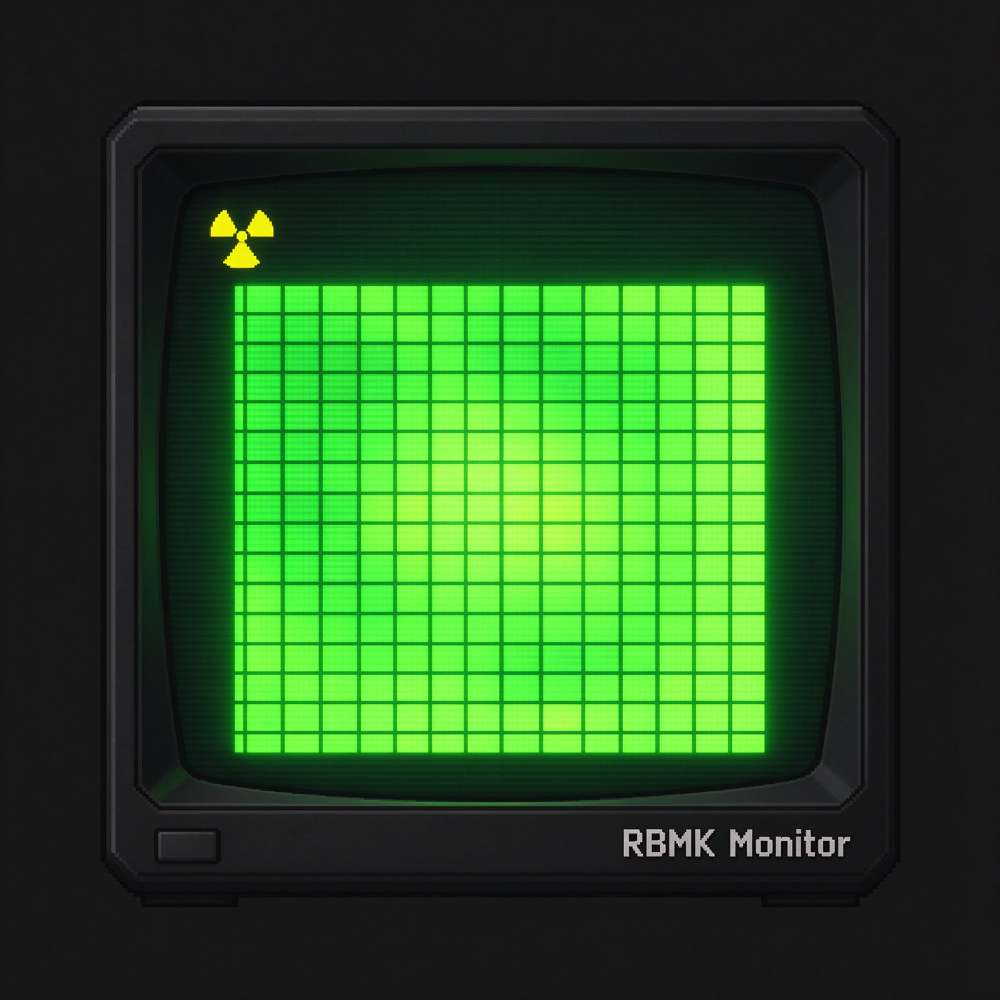

# ☢️ RBMK 监控屏 · RBMK Monitor

**把切尔诺贝利的控制室，搬进 Minecraft。**
**📢 玩家交流与 Bug 反馈 QQ 群：1044038319**


基于节枝 DFC 特效工具二次创作的 HBM 核科技（NTM-CE）RBMK 沸水堆实时监控模组。前置模组：https://gitee.com/yi-sichen-jiezhi/DFC-Map-Creation-Tool

<br />


</div>

---

## 📖 项目简介

一块 **4 宽 × 3 高**的吊装多方块大屏，开机自检动画亮起后，你的 RBMK 反应堆就有了真正的主控台——柱温、中子通量、氙毒化、控制棒抽出率、熔毁风险，一屏尽收眼底。

通过**反射**读取 HBM NTM-CE 数据，**零硬依赖**：没装 HBM 也不会崩，屏幕只显示"数据源未绑定"。

---

## ✨ 功能特性

### 📊 三块屏，同一台硬件

| 方块 | 显示内容 |
|:---|:---|
| 🖥️ **RBMK 监控显示器** | 总览仪表盘：平均柱温 / 最高柱温与熔毁阈值 / 温升速率 / 中子通量 / 蒸汽总量 / 燃料平均富集度 / 氙毒化 / 控制棒抽出率 / 熔毁风险盘 / 事件日志 |
| 🌡️ **RBMK 堆芯监视器** | 15×15 堆芯热图，每格按柱温着色（绿→黄→橙→红），过热格描亮边，侧栏给堆芯分类统计与图例 |
| 📋 **RBMK 自定义显示屏** | 右键打开面板，最多挂 **8 条**外部设备读数（储罐液位 / 电池电量） |

### 🎯 细节拉满

- 🚨 **熔毁告警** — 柱温越限或燃料芯温达熔点，整屏瞬间切到「MELTDOWN」报错页，4 秒后自动重启
- 🧊 **冷堆灰显** — 平均柱温 < 100°C 且通量为 0，屏幕灰显"冷堆"，不算故障
- 📡 **离线状态** — 绑定成功但扫描区没柱子，显示"离线"，不报错不卡死
- 🎮 **遥控器巡检** — 右键控制台/部件记录数据源 → 右键屏幕绑定；蹲下右键储罐/电池挂外部读数；蹲下右键空气清空
- 🔌 **零硬依赖** — 反射读取 HBM 数据，不装 HBM 也不崩

---

## 📁 仓库结构

```
rbmk-monitor/
├── assets/
│   └── logo.png                  # 仓库 Logo
├── prebuilt/
│   └── jiezhi-rbmk-monitor-1.12.2-1.0.0-rbmk.jar   # 预编译发布包
├── screenshots/                   # 游戏内截图（待补充）
├── src/main/
│   ├── java/com/jiezhimod/
│   │   ├── JiezhiMod.java         # mod 入口
│   │   ├── block/                 # 方块 + TileEntity + 多方块结构
│   │   ├── client/dfc/            # 屏幕渲染、画布、字体
│   │   ├── client/gui/            # 自定义显示屏 GUI
│   │   ├── client/util/           # GUI 绘制工具
│   │   ├── dfc/                   # RBMK 数据桥（反射层）、快照、布局
│   │   ├── item/                  # 遥控器
│   │   ├── network/               # 网络包
│   │   └── proxy/                 # 客户端/服务端代理
│   └── resources/
│       ├── mcmod.info
│       ├── pack.mcmeta
│       └── assets/jiezhimod/     # 语言、blockstates、模型、贴图
├── build.gradle                   # ForgeGradle 2.3 构建脚本
├── settings.gradle
├── gradle.properties
├── .gitignore
├── LICENSE                        # GPLv3
└── README.md
```

---

## 🚀 快速开始

### 直接游玩

去 [Releases](../../releases) 下载最新版 `.jar`，丢进 `.minecraft/mods/` 文件夹。

进游戏后用指令拿物品：

```mcfunction
/give @p jiezhirbmkmod:rbmk_screen
/give @p jiezhirbmkmod:rbmk_monitor
/give @p jiezhirbmkmod:rbmk_custom
/give @p jiezhirbmkmod:rbmk_remote

```

> 物品都在创造模式物品栏的 **「RBMK 显示器」** 分组里。

### 上手流程

1. 放一块「RBMK 监控显示器」（4×3 吊装多方块），右键开机
2. 手持「RBMK 遥控器」右键你的 RBMK 控制台（或任意 RBMK 部件）记录数据源
3. 再右键显示器完成绑定——绑部件会自动就近找控制台（半径 24 格）
4. 切到「堆芯监视器」看 15×15 热图；切到「自定义显示屏」蹲下右键遥控器挂储罐/电池
5. 蹲下右键空气，清空遥控器全部记录

---

## 🛠️ 从源码构建

```bash
git clone <仓库地址>
cd rbmk-monitor

# 首次需要先生成 gradle wrapper（需要本机有 Gradle 4.10+）
gradle wrapper --gradle-version 4.10.3

# 构建
./gradlew build

# 产物在 build/libs/
```

**环境要求：** JDK 8、Gradle 4.10+、ForgeGradle 2.3（build.gradle 已配置）。

> 📝 源码由发布版 JAR 通过 CFR 反编译还原，保留 MCP 命名与反射层完整。二次开发建议在 ForgeGradle 环境跑 `genIntellijRuns` 后对照 NTM-CE 源码调试反射字段名。

---

## 📸 截图


---

## 🙏 致谢

| 角色 | 名称 | 链接 |
|:---|:---|:---|
| 原作 | **树上的节枝** — DFC-Map-Creation-Tool v3.9.1 | [B站](https://space.bilibili.com/3494363348863838) · [Gitee](https://gitee.com/yi-sichen-jiezhi/DFC-Map-Creation-Tool) |
| 数据源 | **HBM Nuclear Tech Mod – Community Edition (NTM-CE)** | — |

---

## 📄 许可证

本项目基于 **MPL-2.0** 开源。通过反射读取 HBM 数据，不引用其类、不构成派生，与原作 GPLv3 互不污染。

---

<div align="center">

*☢️ 现实中 RBMK 没有安全壳。在 MC 里请戴好辐射防护。*

</div>
